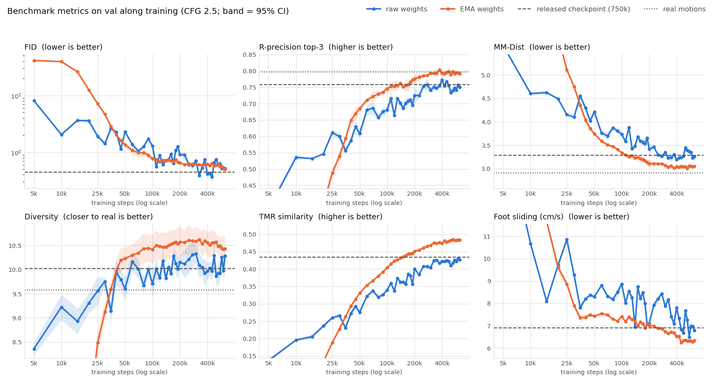
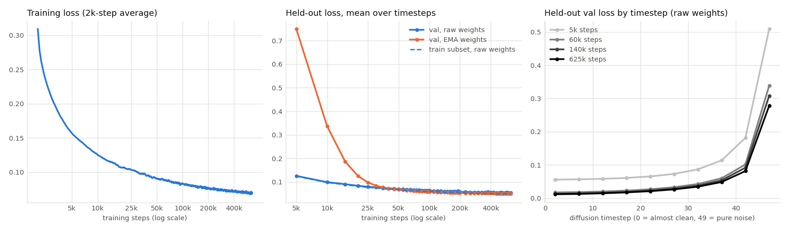

# E003 results: MDM-50 baseline, learning curves and proxy length

_Generated by `experiments/baseline/analyze.py`, 2026-11-16 17:46. Status: **running**, step 649,900 of 750,000._

Run: `save/E003_mdm50_baseline`. Recipe: released MDM-50 config, seed 10; raw weights are the reproduction, EMA (0.9999) is tracked alongside. Benchmark: Guo et al. evaluator on **val**, 1000 motions × 3 replications, MDM sampler (CFG 2.5), mean ± 95% CI. Design: `docs/superpowers/specs/2026-11-14-mdm-baseline-run-design.md`.

Speed with the GPU to itself: **5.56 steps/s** (median of log intervals with no evaluation running); the hours below are steps ÷ this speed, i.e. pure training time. Wall-clock so far: 46.7 h including shared-GPU evaluation.

## Proxy length, raw weights (provisional)

Final = mean of the last 3 evaluated checkpoints (575k, 600k, 625k): FID 0.527, R-top3 0.749, MM-Dist 3.279. Gaps are relative to final; a length passes a level when all three gaps are within it.

- **Within 5% of final on all three, and staying there: from 575k steps (28.7 h of training)**
- **Within 10% of final on all three, and staying there: from 575k steps (28.7 h of training)**
- Measurement noise: one evaluation's 95% CI is ±12% of final for FID, ±1.5% for R-top3, ±1.6% for MM-Dist (mean over the second half of the run). Where this is close to a tolerance, single checkpoints can pass or fail by chance; the candidates around the chosen length get 10 replications after the run.

| Proxy length | Training time | FID | gap | R-top3 | gap | MM-Dist | gap | Passes 5% / 10% |
|---|---|---|---|---|---|---|---|---|
| 25k | 1.2 h | 1.920 ± 0.142 | 264% | 0.611 | 18.4% | 4.155 | 26.7% | no / no |
| 50k | 2.5 h | 2.304 ± 0.074 | 337% | 0.608 | 18.8% | 4.214 | 28.5% | no / no |
| 100k | 5.0 h | 1.287 ± 0.099 | 144% | 0.681 | 9.1% | 3.738 | 14.0% | no / no |
| 150k | 7.5 h | 0.742 ± 0.091 | 41% | 0.686 | 8.4% | 3.683 | 12.3% | no / no |
| 200k | 10.0 h | 0.909 ± 0.030 | 72% | 0.725 | 3.3% | 3.417 | 4.2% | no / no |
| 300k | 15.0 h | 0.710 ± 0.033 | 35% | 0.742 | 1.0% | 3.344 | 2.0% | no / no |
| 400k | 20.0 h | 0.417 ± 0.060 | 21% | 0.772 | 3.0% | 3.195 | 2.6% | no / no |

Checkpoint-to-checkpoint spread of FID over the second half of the evaluated checkpoints: std 0.222 (42% of final).

## Proxy length, EMA weights (provisional)

Final = mean of the last 3 evaluated checkpoints (575k, 600k, 625k): FID 0.530, R-top3 0.793, MM-Dist 3.049. Gaps are relative to final; a length passes a level when all three gaps are within it.

- **Within 5% of final on all three, and staying there: from 600k steps (30.0 h of training)**
- **Within 10% of final on all three, and staying there: from 550k steps (27.5 h of training)**
- Measurement noise: one evaluation's 95% CI is ±6% of final for FID, ±1.1% for R-top3, ±1.4% for MM-Dist (mean over the second half of the run). Where this is close to a tolerance, single checkpoints can pass or fail by chance; the candidates around the chosen length get 10 replications after the run.

| Proxy length | Training time | FID | gap | R-top3 | gap | MM-Dist | gap | Passes 5% / 10% |
|---|---|---|---|---|---|---|---|---|
| 25k | 1.2 h | 7.150 ± 0.244 | 1249% | 0.488 | 38.5% | 5.112 | 67.7% | no / no |
| 50k | 2.5 h | 1.355 ± 0.130 | 156% | 0.685 | 13.7% | 3.746 | 22.9% | no / no |
| 100k | 5.0 h | 0.770 ± 0.075 | 45% | 0.745 | 6.0% | 3.340 | 9.5% | no / no |
| 150k | 7.5 h | 0.735 ± 0.054 | 39% | 0.752 | 5.3% | 3.238 | 6.2% | no / no |
| 200k | 10.0 h | 0.655 ± 0.005 | 24% | 0.776 | 2.2% | 3.105 | 1.8% | no / no |
| 300k | 15.0 h | 0.615 ± 0.018 | 16% | 0.793 | 0.1% | 3.072 | 0.7% | no / no |
| 400k | 20.0 h | 0.620 ± 0.027 | 17% | 0.792 | 0.1% | 3.041 | 0.3% | no / no |

Checkpoint-to-checkpoint spread of FID over the second half of the evaluated checkpoints: std 0.052 (10% of final).

## All evaluated checkpoints (val, CFG 2.5)

| Step | Train time | Weights | FID ↓ | R@1 ↑ | R@3 ↑ | MM-Dist ↓ | Diversity → | TMR sim ↑ | Foot slide cm/s ↓ | Floating % ↓ | Held-out loss val / train |
|---|---|---|---|---|---|---|---|---|---|---|---|
| 5k | 0.2 h | raw | 8.100 ± 0.031 | 0.157 | 0.378 ± 0.009 | 5.634 | 8.36 | 0.137 | 16.1 | 10.9 | 0.1261 / 0.1245 |
| 5k | 0.2 h | ema | 41.255 ± 0.086 | 0.039 | 0.111 ± 0.005 | 7.777 | 2.72 | -0.005 | 17.2 | 0.0 | 0.7492 / 0.7287 |
| 10k | 0.5 h | raw | 2.052 ± 0.098 | 0.242 | 0.535 ± 0.008 | 4.605 | 9.22 | 0.196 | 10.7 | 10.0 | 0.0995 / 0.0976 |
| 10k | 0.5 h | ema | 39.452 ± 0.118 | 0.081 | 0.212 ± 0.005 | 7.265 | 3.49 | 0.024 | 19.7 | 0.4 | 0.3370 / 0.3316 |
| 15k | 0.7 h | raw | 3.638 ± 0.102 | 0.254 | 0.532 ± 0.001 | 4.627 | 8.93 | 0.205 | 8.1 | 4.6 | 0.0909 / 0.0886 |
| 15k | 0.7 h | ema | 26.141 ± 0.406 | 0.130 | 0.315 ± 0.009 | 6.600 | 4.88 | 0.085 | 11.7 | 1.8 | 0.1873 / 0.1847 |
| 20k | 1.0 h | raw | 3.579 ± 0.309 | 0.271 | 0.546 ± 0.001 | 4.491 | 9.31 | 0.236 | 9.7 | 5.6 | 0.0842 / 0.0815 |
| 20k | 1.0 h | ema | 12.543 ± 0.551 | 0.164 | 0.391 ± 0.014 | 5.843 | 6.88 | 0.133 | 9.6 | 3.7 | 0.1261 / 0.1238 |
| 25k | 1.2 h | raw | 1.920 ± 0.142 | 0.309 | 0.611 ± 0.009 | 4.155 | 9.56 | 0.260 | 10.9 | 11.0 | 0.0799 / 0.0772 |
| 25k | 1.2 h | ema | 7.150 ± 0.244 | 0.224 | 0.488 ± 0.015 | 5.112 | 8.49 | 0.188 | 8.9 | 3.5 | 0.0986 / 0.0962 |
| 30k | 1.5 h | raw | 1.421 ± 0.142 | 0.321 | 0.599 ± 0.010 | 4.100 | 9.76 | 0.266 | 9.3 | 9.2 | 0.0778 / 0.0750 |
| 30k | 1.5 h | ema | 4.675 ± 0.129 | 0.257 | 0.540 ± 0.022 | 4.756 | 9.12 | 0.227 | 7.9 | 4.2 | 0.0849 / 0.0823 |
| 35k | 1.7 h | raw | 2.626 ± 0.321 | 0.278 | 0.556 ± 0.012 | 4.557 | 9.14 | 0.231 | 7.8 | 5.7 | 0.0747 / 0.0716 |
| 35k | 1.7 h | ema | 2.870 ± 0.130 | 0.298 | 0.593 ± 0.008 | 4.358 | 9.59 | 0.263 | 7.4 | 5.6 | 0.0774 / 0.0745 |
| 40k | 2.0 h | raw | 2.277 ± 0.097 | 0.295 | 0.586 ± 0.009 | 4.298 | 9.94 | 0.272 | 8.2 | 8.9 | 0.0729 / 0.0696 |
| 40k | 2.0 h | ema | 2.022 ± 0.089 | 0.330 | 0.648 ± 0.021 | 4.039 | 9.98 | 0.293 | 7.4 | 6.7 | 0.0728 / 0.0698 |
| 45k | 2.2 h | raw | 1.146 ± 0.069 | 0.338 | 0.630 ± 0.019 | 4.023 | 9.80 | 0.293 | 8.4 | 10.6 | 0.0725 / 0.0693 |
| 45k | 2.2 h | ema | 1.606 ± 0.133 | 0.355 | 0.669 ± 0.019 | 3.861 | 10.20 | 0.312 | 7.5 | 7.0 | 0.0697 / 0.0667 |
| 50k | 2.5 h | raw | 2.304 ± 0.074 | 0.311 | 0.608 ± 0.014 | 4.214 | 9.60 | 0.276 | 8.3 | 10.5 | 0.0705 / 0.0670 |
| 50k | 2.5 h | ema | 1.355 ± 0.130 | 0.373 | 0.685 ± 0.011 | 3.746 | 10.23 | 0.331 | 7.4 | 6.7 | 0.0676 / 0.0645 |
| 60k | 3.0 h | raw | 1.371 ± 0.134 | 0.381 | 0.680 ± 0.014 | 3.764 | 10.16 | 0.322 | 8.8 | 8.7 | 0.0681 / 0.0646 |
| 60k | 3.0 h | ema | 1.077 ± 0.165 | 0.395 | 0.711 ± 0.006 | 3.587 | 10.30 | 0.353 | 7.5 | 7.1 | 0.0646 / 0.0613 |
| 70k | 3.5 h | raw | 1.052 ± 0.041 | 0.377 | 0.686 ± 0.021 | 3.700 | 10.02 | 0.337 | 8.3 | 7.7 | 0.0669 / 0.0632 |
| 70k | 3.5 h | ema | 0.982 ± 0.166 | 0.409 | 0.722 ± 0.015 | 3.507 | 10.35 | 0.367 | 7.5 | 7.4 | 0.0626 / 0.0591 |
| 80k | 4.0 h | raw | 1.261 ± 0.104 | 0.365 | 0.657 ± 0.009 | 3.875 | 9.68 | 0.319 | 8.2 | 5.9 | 0.0662 / 0.0624 |
| 80k | 4.0 h | ema | 0.983 ± 0.136 | 0.422 | 0.729 ± 0.010 | 3.472 | 10.44 | 0.380 | 7.3 | 7.2 | 0.0609 / 0.0574 |
| 90k | 4.5 h | raw | 1.732 ± 0.104 | 0.362 | 0.675 ± 0.014 | 3.806 | 10.00 | 0.326 | 8.5 | 7.7 | 0.0640 / 0.0599 |
| 90k | 4.5 h | ema | 0.890 ± 0.094 | 0.435 | 0.734 ± 0.007 | 3.412 | 10.45 | 0.392 | 7.2 | 7.4 | 0.0597 / 0.0560 |
| 100k | 5.0 h | raw | 1.287 ± 0.099 | 0.383 | 0.681 ± 0.011 | 3.738 | 9.71 | 0.340 | 8.9 | 7.8 | 0.0637 / 0.0596 |
| 100k | 5.0 h | ema | 0.770 ± 0.075 | 0.446 | 0.745 ± 0.010 | 3.340 | 10.42 | 0.404 | 7.4 | 8.0 | 0.0588 / 0.0551 |
| 110k | 5.5 h | raw | 0.554 ± 0.024 | 0.418 | 0.715 ± 0.023 | 3.579 | 10.01 | 0.360 | 8.0 | 8.9 | 0.0624 / 0.0583 |
| 110k | 5.5 h | ema | 0.748 ± 0.072 | 0.451 | 0.753 ± 0.012 | 3.294 | 10.51 | 0.414 | 7.2 | 8.1 | 0.0579 / 0.0540 |
| 120k | 6.0 h | raw | 0.889 ± 0.034 | 0.366 | 0.664 ± 0.007 | 3.882 | 9.83 | 0.338 | 8.5 | 15.1 | 0.0627 / 0.0584 |
| 120k | 6.0 h | ema | 0.686 ± 0.065 | 0.451 | 0.753 ± 0.016 | 3.257 | 10.49 | 0.424 | 7.4 | 8.2 | 0.0572 / 0.0532 |
| 130k | 6.5 h | raw | 0.607 ± 0.076 | 0.433 | 0.716 ± 0.006 | 3.425 | 10.18 | 0.374 | 8.3 | 11.8 | 0.0619 / 0.0574 |
| 130k | 6.5 h | ema | 0.717 ± 0.085 | 0.457 | 0.755 ± 0.014 | 3.274 | 10.47 | 0.427 | 7.3 | 8.3 | 0.0566 / 0.0525 |
| 140k | 7.0 h | raw | 0.724 ± 0.017 | 0.399 | 0.702 ± 0.010 | 3.481 | 9.82 | 0.363 | 6.9 | 5.8 | 0.0607 / 0.0568 |
| 140k | 7.0 h | ema | 0.707 ± 0.051 | 0.459 | 0.762 ± 0.009 | 3.232 | 10.47 | 0.431 | 7.2 | 8.2 | 0.0561 / 0.0520 |
| 150k | 7.5 h | raw | 0.742 ± 0.091 | 0.392 | 0.686 ± 0.011 | 3.683 | 10.05 | 0.362 | 8.7 | 6.7 | 0.0599 / 0.0559 |
| 150k | 7.5 h | ema | 0.735 ± 0.054 | 0.452 | 0.752 ± 0.008 | 3.238 | 10.50 | 0.435 | 7.0 | 7.9 | 0.0556 / 0.0514 |
| 160k | 8.0 h | raw | 0.928 ± 0.144 | 0.409 | 0.701 ± 0.016 | 3.588 | 9.92 | 0.357 | 8.2 | 6.5 | 0.0601 / 0.0558 |
| 160k | 8.0 h | ema | 0.707 ± 0.027 | 0.461 | 0.756 ± 0.019 | 3.210 | 10.53 | 0.438 | 7.2 | 7.7 | 0.0552 / 0.0510 |
| 170k | 8.5 h | raw | 0.637 ± 0.050 | 0.415 | 0.708 ± 0.011 | 3.566 | 10.29 | 0.385 | 8.5 | 11.6 | 0.0606 / 0.0559 |
| 170k | 8.5 h | ema | 0.682 ± 0.037 | 0.462 | 0.758 ± 0.018 | 3.192 | 10.55 | 0.444 | 7.1 | 7.5 | 0.0548 / 0.0506 |
| 180k | 9.0 h | raw | 1.080 ± 0.071 | 0.397 | 0.712 ± 0.008 | 3.538 | 10.13 | 0.380 | 8.0 | 10.6 | 0.0595 / 0.0549 |
| 180k | 9.0 h | ema | 0.750 ± 0.021 | 0.469 | 0.766 ± 0.009 | 3.170 | 10.57 | 0.444 | 6.9 | 7.3 | 0.0545 / 0.0502 |
| 190k | 9.5 h | raw | 1.265 ± 0.012 | 0.390 | 0.695 ± 0.012 | 3.658 | 10.02 | 0.356 | 7.1 | 12.2 | 0.0615 / 0.0568 |
| 190k | 9.5 h | ema | 0.676 ± 0.022 | 0.479 | 0.772 ± 0.008 | 3.130 | 10.54 | 0.445 | 7.1 | 7.3 | 0.0543 / 0.0498 |
| 200k | 10.0 h | raw | 0.909 ± 0.030 | 0.440 | 0.725 ± 0.025 | 3.417 | 10.15 | 0.400 | 7.1 | 7.3 | 0.0581 / 0.0536 |
| 200k | 10.0 h | ema | 0.655 ± 0.005 | 0.488 | 0.776 ± 0.013 | 3.105 | 10.58 | 0.451 | 7.0 | 7.6 | 0.0541 / 0.0496 |
| 225k | 11.2 h | raw | 0.904 ± 0.133 | 0.420 | 0.725 ± 0.007 | 3.465 | 10.12 | 0.384 | 7.9 | 9.5 | 0.0586 / 0.0535 |
| 225k | 11.2 h | ema | 0.607 ± 0.027 | 0.483 | 0.781 ± 0.010 | 3.108 | 10.56 | 0.454 | 7.0 | 7.7 | 0.0534 / 0.0488 |
| 250k | 12.5 h | raw | 0.610 ± 0.050 | 0.445 | 0.752 ± 0.009 | 3.296 | 10.22 | 0.408 | 8.2 | 10.8 | 0.0574 / 0.0525 |
| 250k | 12.5 h | ema | 0.624 ± 0.027 | 0.487 | 0.785 ± 0.007 | 3.105 | 10.61 | 0.461 | 6.9 | 7.2 | 0.0532 / 0.0482 |
| 275k | 13.7 h | raw | 0.590 ± 0.103 | 0.434 | 0.758 ± 0.019 | 3.264 | 10.31 | 0.408 | 8.4 | 7.6 | 0.0570 / 0.0520 |
| 275k | 13.7 h | ema | 0.613 ± 0.028 | 0.481 | 0.787 ± 0.001 | 3.102 | 10.60 | 0.466 | 6.9 | 7.2 | 0.0527 / 0.0477 |
| 300k | 15.0 h | raw | 0.710 ± 0.033 | 0.439 | 0.742 ± 0.008 | 3.344 | 10.33 | 0.404 | 7.9 | 9.7 | 0.0573 / 0.0520 |
| 300k | 15.0 h | ema | 0.615 ± 0.018 | 0.480 | 0.793 ± 0.005 | 3.072 | 10.59 | 0.468 | 6.7 | 7.5 | 0.0524 / 0.0472 |
| 325k | 16.2 h | raw | 0.391 ± 0.063 | 0.466 | 0.750 ± 0.013 | 3.230 | 10.09 | 0.424 | 8.2 | 8.0 | 0.0568 / 0.0513 |
| 325k | 16.2 h | ema | 0.603 ± 0.025 | 0.504 | 0.793 ± 0.007 | 3.036 | 10.63 | 0.475 | 6.7 | 7.1 | 0.0523 / 0.0469 |
| 350k | 17.5 h | raw | 0.531 ± 0.048 | 0.460 | 0.748 ± 0.009 | 3.239 | 10.05 | 0.425 | 7.4 | 7.9 | 0.0562 / 0.0508 |
| 350k | 17.5 h | ema | 0.589 ± 0.034 | 0.502 | 0.793 ± 0.010 | 3.061 | 10.54 | 0.474 | 6.7 | 7.4 | 0.0521 / 0.0466 |
| 375k | 18.7 h | raw | 0.749 ± 0.085 | 0.449 | 0.754 ± 0.007 | 3.302 | 9.92 | 0.417 | 7.1 | 9.4 | 0.0575 / 0.0521 |
| 375k | 18.7 h | ema | 0.611 ± 0.031 | 0.502 | 0.803 ± 0.009 | 3.011 | 10.60 | 0.476 | 6.7 | 7.4 | 0.0520 / 0.0463 |
| 400k | 20.0 h | raw | 0.417 ± 0.060 | 0.468 | 0.772 ± 0.009 | 3.195 | 9.97 | 0.422 | 7.8 | 6.5 | 0.0564 / 0.0508 |
| 400k | 20.0 h | ema | 0.620 ± 0.027 | 0.505 | 0.792 ± 0.015 | 3.041 | 10.56 | 0.474 | 6.5 | 7.3 | 0.0518 / 0.0461 |
| 425k | 21.2 h | raw | 0.421 ± 0.032 | 0.464 | 0.754 ± 0.012 | 3.234 | 10.03 | 0.422 | 7.3 | 7.6 | 0.0561 / 0.0500 |
| 425k | 21.2 h | ema | 0.591 ± 0.018 | 0.501 | 0.792 ± 0.009 | 3.032 | 10.51 | 0.481 | 6.5 | 7.4 | 0.0516 / 0.0457 |
| 450k | 22.5 h | raw | 0.370 ± 0.076 | 0.463 | 0.767 ± 0.013 | 3.245 | 9.97 | 0.424 | 6.8 | 8.9 | 0.0553 / 0.0495 |
| 450k | 22.5 h | ema | 0.639 ± 0.010 | 0.499 | 0.795 ± 0.009 | 3.053 | 10.55 | 0.477 | 6.2 | 8.2 | 0.0513 / 0.0455 |
| 475k | 23.7 h | raw | 0.657 ± 0.048 | 0.467 | 0.756 ± 0.007 | 3.271 | 10.29 | 0.422 | 6.7 | 8.5 | 0.0554 / 0.0494 |
| 475k | 23.7 h | ema | 0.575 ± 0.026 | 0.498 | 0.798 ± 0.015 | 3.044 | 10.57 | 0.480 | 6.3 | 7.7 | 0.0512 / 0.0453 |
| 500k | 25.0 h | raw | 0.741 ± 0.131 | 0.436 | 0.734 ± 0.013 | 3.450 | 9.87 | 0.410 | 7.7 | 9.0 | 0.0573 / 0.0505 |
| 500k | 25.0 h | ema | 0.597 ± 0.036 | 0.499 | 0.788 ± 0.012 | 3.042 | 10.57 | 0.483 | 6.4 | 7.3 | 0.0512 / 0.0451 |
| 525k | 26.2 h | raw | 0.618 ± 0.088 | 0.449 | 0.740 ± 0.005 | 3.395 | 9.93 | 0.417 | 7.3 | 9.0 | 0.0553 / 0.0491 |
| 525k | 26.2 h | ema | 0.614 ± 0.058 | 0.499 | 0.798 ± 0.011 | 3.005 | 10.49 | 0.485 | 6.3 | 7.6 | 0.0511 / 0.0450 |
| 550k | 27.5 h | raw | 0.633 ± 0.080 | 0.441 | 0.748 ± 0.016 | 3.362 | 9.92 | 0.425 | 6.5 | 11.6 | 0.0555 / 0.0493 |
| 550k | 27.5 h | ema | 0.567 ± 0.055 | 0.502 | 0.792 ± 0.008 | 3.060 | 10.49 | 0.483 | 6.3 | 9.1 | 0.0510 / 0.0449 |
| 575k | 28.7 h | raw | 0.524 ± 0.063 | 0.449 | 0.741 ± 0.008 | 3.349 | 10.26 | 0.422 | 7.0 | 6.6 | 0.0565 / 0.0503 |
| 575k | 28.7 h | ema | 0.568 ± 0.057 | 0.500 | 0.794 ± 0.003 | 3.052 | 10.44 | 0.483 | 6.3 | 8.4 | 0.0509 / 0.0447 |
| 600k | 30.0 h | raw | 0.533 ± 0.037 | 0.456 | 0.757 ± 0.005 | 3.230 | 9.98 | 0.431 | 7.0 | 7.5 | 0.0549 / 0.0484 |
| 600k | 30.0 h | ema | 0.516 ± 0.029 | 0.504 | 0.795 ± 0.005 | 3.043 | 10.43 | 0.484 | 6.3 | 8.4 | 0.0508 / 0.0445 |
| 625k | 31.2 h | raw | 0.524 ± 0.058 | 0.458 | 0.750 ± 0.015 | 3.259 | 10.29 | 0.427 | 6.8 | 11.4 | 0.0547 / 0.0481 |
| 625k | 31.2 h | ema | 0.505 ± 0.036 | 0.496 | 0.792 ± 0.007 | 3.054 | 10.43 | 0.484 | 6.3 | 8.3 | 0.0508 / 0.0443 |
| *released, 750k* | | raw | 0.447 | | 0.758 | 3.283 | 10.02 | 0.434 | 6.9 | | |
| *real motions* | | | ~0 | | 0.797 | 2.906 | 9.58 | | | | |

## Other evaluations

| Split | Sampler | Weights | Step | Reps | FID ↓ | R@3 ↑ | MM-Dist ↓ | Diversity → |
|---|---|---|---|---|---|---|---|---|
| test | cfg2.5 | ema | 600k | 20 | 0.584 ± 0.026 | 0.786 ± 0.006 | 3.105 | 10.13 |
| test | cfg2.5 | raw | 600k | 20 | 0.626 ± 0.047 | 0.753 ± 0.005 | 3.277 | 9.69 |
| val | apg4 | ema | 50k | 3 | 1.084 ± 0.070 | 0.720 ± 0.008 | 3.545 | 10.24 |
| val | apg4 | ema | 100k | 3 | 0.595 ± 0.058 | 0.767 ± 0.017 | 3.219 | 10.43 |
| val | apg4 | ema | 150k | 3 | 0.574 ± 0.067 | 0.789 ± 0.016 | 3.118 | 10.46 |
| val | apg4 | ema | 200k | 3 | 0.535 ± 0.064 | 0.787 ± 0.010 | 3.027 | 10.60 |
| val | apg4 | ema | 250k | 3 | 0.462 ± 0.029 | 0.802 ± 0.008 | 3.012 | 10.59 |
| val | apg4 | ema | 300k | 3 | 0.485 ± 0.011 | 0.803 ± 0.012 | 3.002 | 10.56 |
| val | apg4 | ema | 350k | 3 | 0.422 ± 0.008 | 0.803 ± 0.005 | 2.980 | 10.46 |
| val | apg4 | ema | 400k | 3 | 0.464 ± 0.053 | 0.799 ± 0.010 | 2.976 | 10.47 |
| val | apg4 | ema | 450k | 3 | 0.438 ± 0.011 | 0.809 ± 0.011 | 2.968 | 10.42 |
| val | apg4 | ema | 500k | 3 | 0.423 ± 0.021 | 0.808 ± 0.015 | 2.947 | 10.49 |
| val | apg4 | ema | 550k | 3 | 0.403 ± 0.046 | 0.799 ± 0.005 | 2.960 | 10.38 |
| val | apg4 | ema | 600k | 3 | 0.348 ± 0.027 | 0.796 ± 0.006 | 2.979 | 10.31 |
| val | apg4 | raw | 50k | 3 | 1.632 ± 0.044 | 0.645 ± 0.009 | 3.930 | 9.49 |
| val | apg4 | raw | 100k | 3 | 0.873 ± 0.039 | 0.691 ± 0.002 | 3.615 | 9.71 |
| val | apg4 | raw | 150k | 3 | 0.542 ± 0.086 | 0.706 ± 0.015 | 3.556 | 9.98 |
| val | apg4 | raw | 200k | 3 | 0.703 ± 0.026 | 0.748 ± 0.013 | 3.312 | 10.17 |
| val | apg4 | raw | 250k | 3 | 0.452 ± 0.064 | 0.763 ± 0.010 | 3.207 | 10.13 |
| val | apg4 | raw | 300k | 3 | 0.472 ± 0.034 | 0.754 ± 0.019 | 3.306 | 10.13 |
| val | apg4 | raw | 350k | 3 | 0.378 ± 0.059 | 0.764 ± 0.010 | 3.161 | 9.97 |
| val | apg4 | raw | 400k | 3 | 0.309 ± 0.032 | 0.765 ± 0.014 | 3.200 | 9.84 |
| val | apg4 | raw | 450k | 3 | 0.327 ± 0.052 | 0.772 ± 0.003 | 3.176 | 9.81 |
| val | apg4 | raw | 500k | 3 | 0.799 ± 0.141 | 0.732 ± 0.009 | 3.451 | 9.73 |
| val | apg4 | raw | 550k | 3 | 0.455 ± 0.054 | 0.758 ± 0.019 | 3.261 | 9.83 |
| val | apg4 | raw | 600k | 3 | 0.479 ± 0.078 | 0.763 ± 0.009 | 3.153 | 9.88 |
